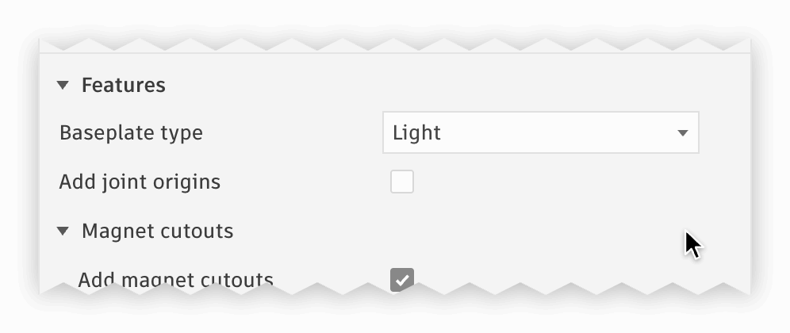
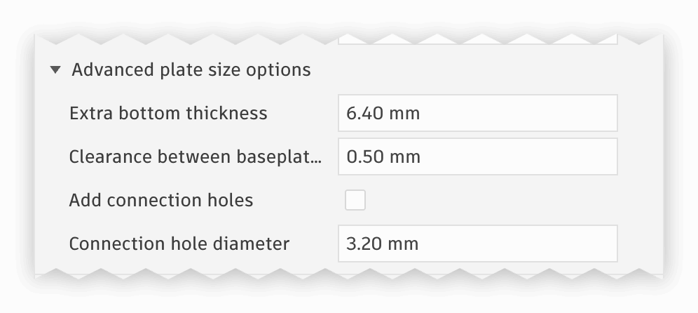
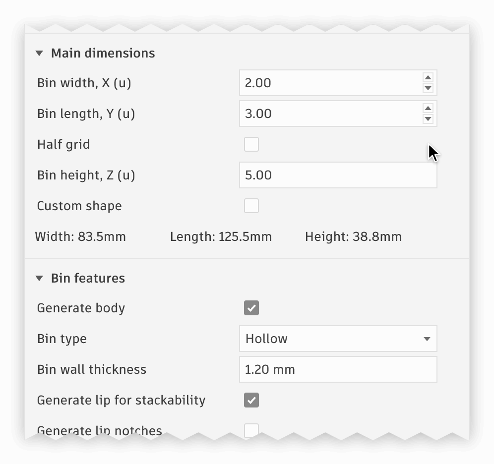
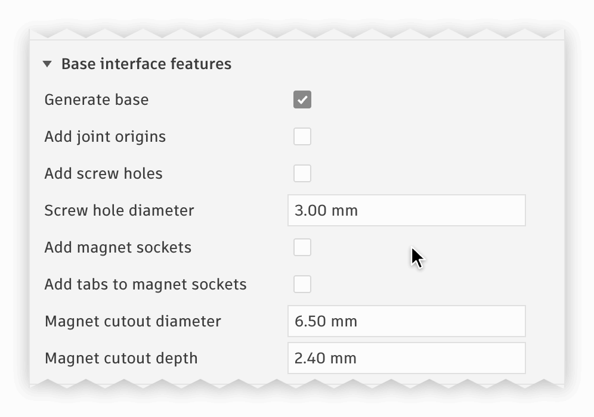
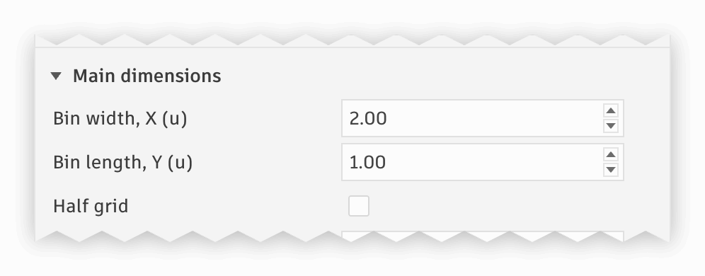
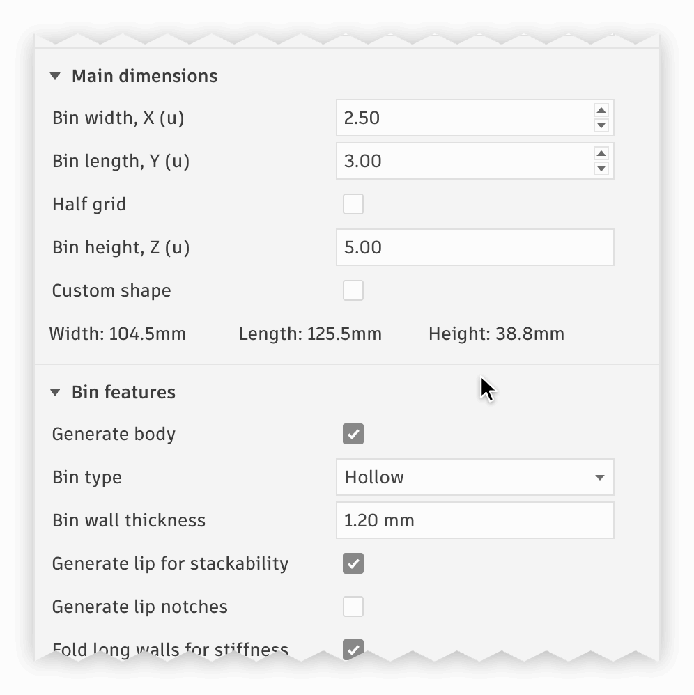
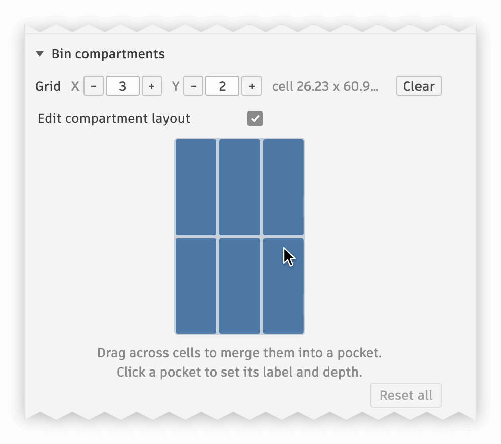
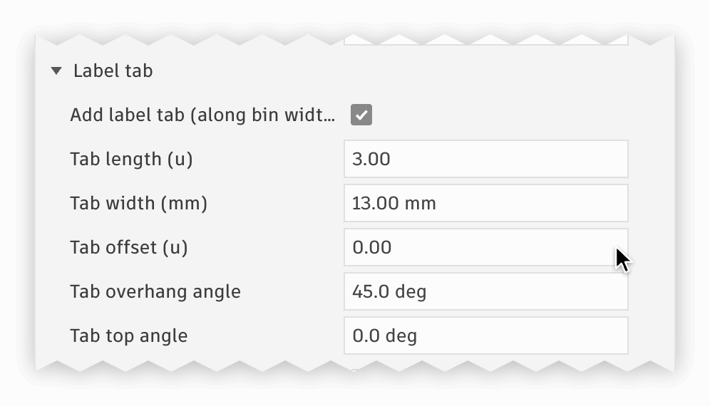
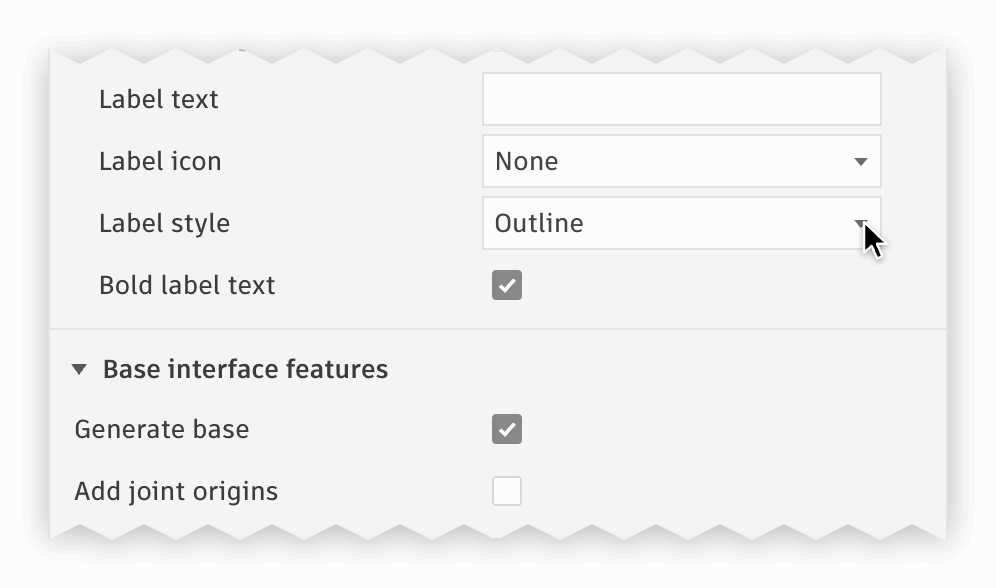

[![CC BY-NC-SA 4.0][cc-by-nc-sa-shield]][cc-by-nc-sa]

## Description
Add-In for Fusion 360 allowing quick generation of simple [gridfinity](https://www.youtube.com/watch?v=ra_9zU-mnl8) bins and baseplates. The created bodies are parametric and can be easily edited if needed before exporting. Bins have an option to be generated solid providing a kick start for specialized tool bins creation.

## Features

Each option is described in details on the project [wiki page](https://github.com/Le0Michine/FusionGridfinityGenerator/wiki).

Bin options | Baseplate options
:-------------------------:|:-------------------------:
 | 

### Baseplates
- accepts amount of bases X and Y directions
- fill area mode takes the size of an area, e.g. a drawer, and a print bed, picked from popular printers or entered by hand, fits a grid into the area and splits it into pieces fitting the bed. The grid can be centered or pushed to a side, and space left past it can take a row of half cells instead of solid padding
- base measurement can be changed, default is 42mm
- there are options to generate thick plate with magnet or/and screw holes
- thick plate can be skeletonized to reduce weight, it also allows room for connection holes which can be customized to fit certain screw size or glue in pin
- size of magnet sockets and screw holes can be adjusted

#### Baseplate types
Result | Options
:-------------------------:|:-------------------------:
<picture><source media="(prefers-color-scheme: dark)" srcset="documentation/assets/gif/baseplate-types-dark.gif"></picture> | <picture><source media="(prefers-color-scheme: dark)" srcset="documentation/assets/gif/baseplate-types-dialog-dark.gif"></picture>

#### Connection holes
Skeletonized baseplates can have holes between them for a screw or a glued in pin, their size can be adjusted

Result | Options
:-------------------------:|:-------------------------:
<picture><source media="(prefers-color-scheme: dark)" srcset="documentation/assets/gif/baseplate-connection-holes-dark.gif"></picture> | <picture><source media="(prefers-color-scheme: dark)" srcset="documentation/assets/gif/baseplate-connection-holes-dialog-dark.gif"></picture>

### Bins
- accepts amount of bases X and Y directions
- base measurement can be changed, default is 42mm for base width and 7mm for the unit of height
- height is specified in base units, 1 unit will be added to the input to accomodate bin bottom
- generated bins can have a lip for better stackability or a straight wall
- lip can have notches preventing bins from sliding when stacked
- wall thickness can be adjusted
- magnet sockets can be customized to allow snug fit of the magnets, or a different size
- magnet sockets can have tabs holding the magnets in
- screw holes diameter can be adjusted
- when magnet and screw holes are enabled together, a groove will be generated to help with printability
- bin can be shelled with constant wall thickness to save printing time and filament
- label tab can be generated (length, offset and overhang angle are adjustable)
- label tab top can be tilted, and the tab can be hollow, opened through the back wall of the bin and optionally its side walls
- allows generation of base or body separately, could be useful if need combine it with existing model
- bins can take a custom shape drawn on the grid, such as an L or a T
- compartments can be configured to use uniform scale
- custom compartmens layout is based on the uniform grid and allows merging multiple cells together, specifying custom depth and position

Result | Options
:-------------------------:|:-------------------------:
<picture><source media="(prefers-color-scheme: dark)" srcset="documentation/assets/gif/bin-features-dark.gif"></picture> | <picture><source media="(prefers-color-scheme: dark)" srcset="documentation/assets/gif/bin-features-editing-dark.gif"></picture>

#### Bin bottom options
Result | Options
:-------------------------:|:-------------------------:
<picture><source media="(prefers-color-scheme: dark)" srcset="documentation/assets/gif/bin-bottom-options-dark.gif"></picture> | <picture><source media="(prefers-color-scheme: dark)" srcset="documentation/assets/gif/bin-bottom-options-dialog-dark.gif"></picture>

#### Bin half base size

Result | Options
:-------------------------:|:-------------------------:
<picture><source media="(prefers-color-scheme: dark)" srcset="documentation/assets/gif/bin-half-grid-dark.gif"></picture> | <picture><source media="(prefers-color-scheme: dark)" srcset="documentation/assets/gif/bin-half-grid-dialog-dark.gif"></picture>

#### Bin type options
Hollow bin | Shelled bin | Solid bin
:-------------------------:|:-------------------------:|:-------------------------:
 |  | 

#### Custom bin shape

The cells of the bin can be picked on its grid, for bins such as an L or a T.

Result | Drawing the shape
:-------------------------:|:-------------------------:
<picture><source media="(prefers-color-scheme: dark)" srcset="documentation/assets/gif/bin-custom-shape-dark.gif"></picture> | <picture><source media="(prefers-color-scheme: dark)" srcset="documentation/assets/gif/bin-custom-shape-drawing-dark.gif"></picture>

#### Bin compartments options

Detailed configuration options are on the [wiki](https://github.com/Le0Michine/FusionGridfinityGenerator/wiki/Bin-generator-options#grid-type)

Uniform compartments | Custom compartments A | Custom compartments B
:-------------------------:|:-------------------------:|:-------------------------:
 |  | 
 |  | 

Compartments are merged by dragging across the cells, and can be named for the label tab

Result | Options
:-------------------------:|:-------------------------:
<picture><source media="(prefers-color-scheme: dark)" srcset="documentation/assets/gif/bin-compartments-dark.gif"></picture> | <picture><source media="(prefers-color-scheme: dark)" srcset="documentation/assets/gif/bin-compartments-merging-dark.gif"></picture>

#### Bin label tab configuration
Result | Options
:-------------------------:|:-------------------------:
<picture><source media="(prefers-color-scheme: dark)" srcset="documentation/assets/gif/bin-label-tab-options-dark.gif"></picture> | <picture><source media="(prefers-color-scheme: dark)" srcset="documentation/assets/gif/bin-label-tab-options-dialog-dark.gif"></picture>

#### Bin labels
A label tab can carry text and an icon, outlined for a slicer to color it, engraved or embossed

Result | Options
:-------------------------:|:-------------------------:
<picture><source media="(prefers-color-scheme: dark)" srcset="documentation/assets/gif/bin-label-options-dark.gif"></picture> | <picture><source media="(prefers-color-scheme: dark)" srcset="documentation/assets/gif/bin-label-options-dialog-dark.gif"></picture>

#### Bin scoop feature
Scoop enabled | Scoop disabled
:-------------------------:|:-------------------------:
 | 


#### Hollow bin


#### Specialized Bin

Creating a 4x2 bin to hold oversized volcano nozzle


Bin for random round things


## Installation

### Via Autodesk App Store

- Download GridfinityGenerator installer from [Autodesk App Store](https://apps.autodesk.com/FUSION/en/Detail/Index?id=7197558650811789) ([MacOS](https://apps.autodesk.com/FUSION/en/Detail/Index?id=7197558650811789&os=Mac&appLang=en) | [Windows](https://apps.autodesk.com/FUSION/en/Detail/Index?id=7197558650811789&os=Win64&appLang=en))
- Run installer and wait for installation to complete, it will automatically close
- Relaunch Fusion 360
- `Gridfinity bin` and `Gridfinity baseplate` options should appear in `Create` menu in the Solid body workspace environment


### From source code
#### Step 1: Download

Download code into a location on your hard drive.
- Option 1: Clone git repository

```
git clone https://github.com/Le0Michine/FusionGridfinityGenerator.git
```
- Option 2: Download ZIP file
  - Use [latest release page](https://github.com/Le0Michine/FusionGridfinityGenerator/releases) to download ZIP file `GridfinityGenerator-vX.X.X.X.zip`. The release page should contain latest stable version. Alternatively you can choose to use `Code / Download ZIP` option (or use this [direct link to the zip](https://github.com/Le0Michine/FusionGridfinityGenerator/archive/refs/heads/master.zip)) to download most recent changes which aren't released yet.
  - Unpack content of the ZIP file into your target location

#### Step 2: Install as Add-In to Fusion 360
- In Fusion open `Scripts and Add-Ins` window by pressing `Shift + S`.
  - It can also be found in the UI `Design -> Utilities -> ADD-INS`
- Select `Add-Ins` tab and press `+` icon to add new add in
- Select path to the repository downloaded in Step 1. Choose the folder containing `GridfinityGenerator.py`.
- `GridfinityGenerator` should appear in the list of add ins
- Select `GridfinityGenerator` and click `Run` to launch the add in
- `Gridfinity bin` and `Gridfinity baseplate` options should appear in `Create` menu in the Solid body workspace environment

## Update

To update the script download latest sources into the same location and relaunch Fusion. If you used Autodesk app store to install the addon please follow the same link then download and install the latest version from there.

## Support the project

The plugin is free. However, if you want to support the project you can do so by [buying me a coffe](https://www.buymeacoffee.com/levmishin) or subscribing on patreon https://www.patreon.com/levmishin.

## Credits

[Gridfinity](https://www.youtube.com/watch?v=ra_9zU-mnl8) by [Zack Freedman](https://www.youtube.com/c/ZackFreedman/about)

This work is licensed under the same license as Gridfinity, being a
[Creative Commons Attribution-NonCommercial-ShareAlike 4.0 International License][cc-by-nc-sa].

[![CC BY-NC-SA 4.0][cc-by-nc-sa-image]][cc-by-nc-sa]

[cc-by-nc-sa]: http://creativecommons.org/licenses/by-nc-sa/4.0/
[cc-by-nc-sa-image]: https://licensebuttons.net/l/by-nc-sa/4.0/88x31.png
[cc-by-nc-sa-shield]: https://img.shields.io/badge/License-CC%20BY--NC--SA%204.0-lightgrey.svg
