The baseplate dialog, under Create > Gridfinity baseplate in the Solid workspace, groups its options in sections, described here in the order the dialog shows them. Defaults are the dialog's original ones, **Save as defaults** in the Inputs section replaces them with your own.

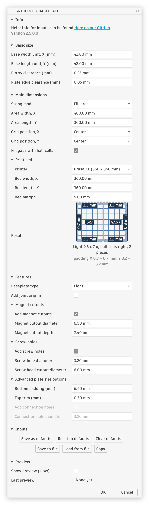

# Info

A link to this page and the add-in's version.

# Basic size

Changing these might affect compatibility with models created by the Gridfinity community, so it isn't recommended. It can still be useful for something that meets your specific needs, such as a grid of a different size for a drawer.

## Base width unit, X (mm)
Default: <!-- default:base_width_unit -->

The width of a grid cell, along X.

## Base length unit, Y (mm)
Default: <!-- default:base_length_unit -->

The length of a grid cell, along Y.

Both go into user parameters of the design, `gfPlate1_baseWidth` and `gfPlate1_baseLength`, the number being the first one available in the design. Changing them in Modify > Change Parameters resizes the cells without generating the baseplate again.

## Bin xy clearance (mm)
Default: <!-- default:bin_xy_clearance -->

The gap on each side between a bin and its cell. Each socket is made the clearance larger than its cell, while a bin's feet are the clearance smaller, so a foot has twice the clearance to its socket. Keep it the same as the **Bin xy clearance** of the bins. From 0.1mm to 0.5mm.

<picture><source media="(prefers-color-scheme: dark)" srcset="../assets/diagrams/bin-xy-clearance-dark.svg">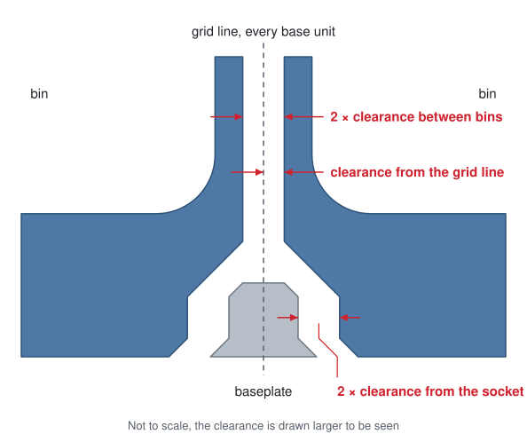</picture>

## Plate edge clearance (mm)
Default: <!-- default:plate_edge_clearance -->

How far the edge of a plate stops short of the grid line where it meets another plate, the pieces of a filled area or plates generated in grid units laid side by side. Two plates together leave twice it between them, while their sockets stay on the grid. From 0.025mm to 0.25mm.

<picture><source media="(prefers-color-scheme: dark)" srcset="../assets/diagrams/baseplate-seam-dark.svg">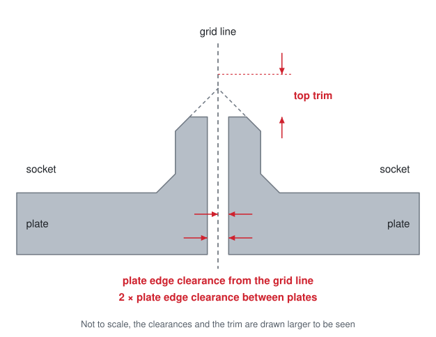</picture>

# Main dimensions

## Sizing mode
Default: <!-- default:sizing_mode_dropdown -->

- **Fill area** fits the grid into an area, such as a drawer, and splits it into pieces fitting your print bed
- **Grid units** makes a single plate of a number of cells, with optional padding on its sides, see **Side padding**

<picture><source media="(prefers-color-scheme: dark)" srcset="../assets/gif/baseplate-fill-area-dark.gif">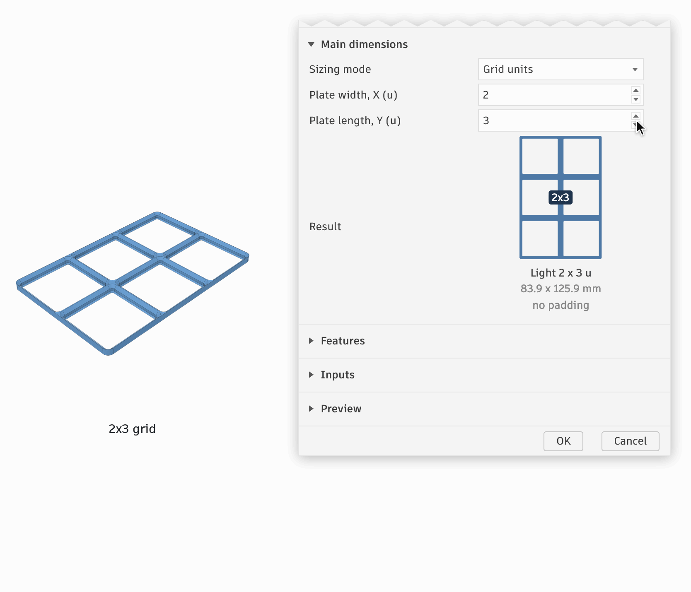</picture>

## Fill area

### Area width, X and Area length, Y
Default: <!-- default:fill_area_width --> by <!-- default:fill_area_length -->

The inside size of the drawer or area to fill. It takes as many whole cells as fit, the space left over goes to padding, or a row of half cells, see **Fill gaps with half cells**. The outer edges keep the **Bin xy clearance**, so the fill drops in without being forced.

### Grid position, X and Grid position, Y
Default: <!-- default:fill_align_x -->, <!-- default:fill_align_y -->

Where the grid goes in the area, the padding takes the rest of the space. **Center** splits it evenly between the sides, **Left**, **Right**, **Front** or **Back** pushes the grid to that side and puts all the padding on the other.

### Fill gaps with half cells
Default: <!-- default:fill_half_cells -->

Where the space left past the whole cells fits a row of half size cells, adds one instead of solid padding, for bins on the half grid, see **Half grid** of the bins.

| | The dialog's Result drawing |
| :--- | :---: |
| Centered, the default | <picture><source media="(prefers-color-scheme: dark)" srcset="../assets/ui/baseplate-fill-centered-dark.png">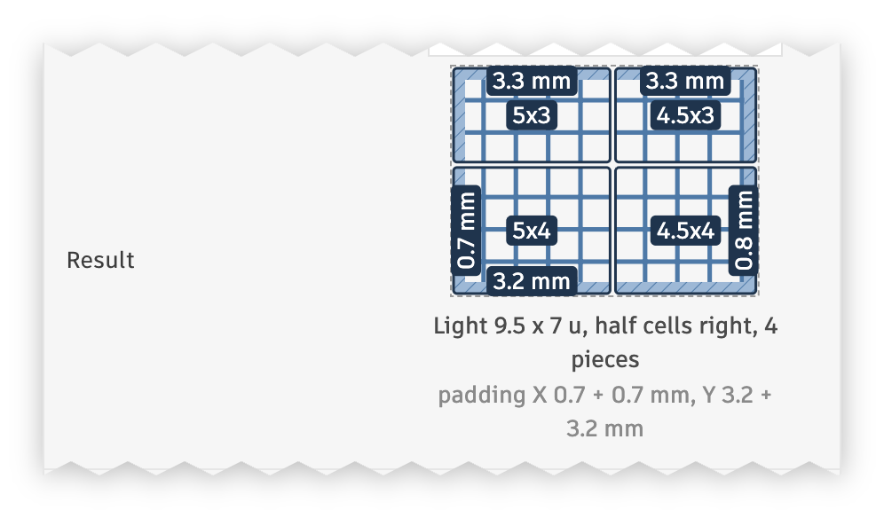</picture> |
| Pushed to the left and front | <picture><source media="(prefers-color-scheme: dark)" srcset="../assets/ui/baseplate-fill-left-front-dark.png">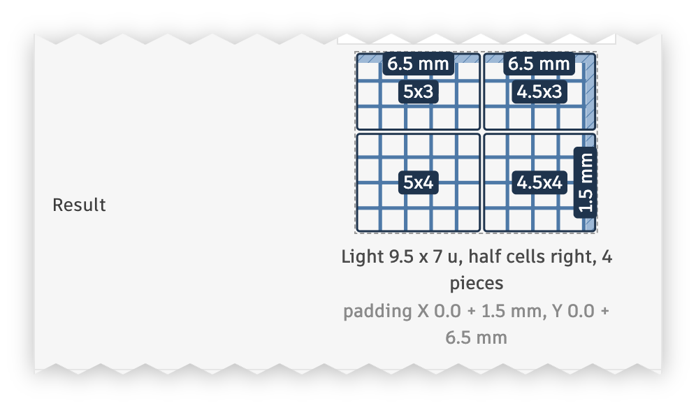</picture> |
| Without half cells | <picture><source media="(prefers-color-scheme: dark)" srcset="../assets/ui/baseplate-fill-no-half-cells-dark.png">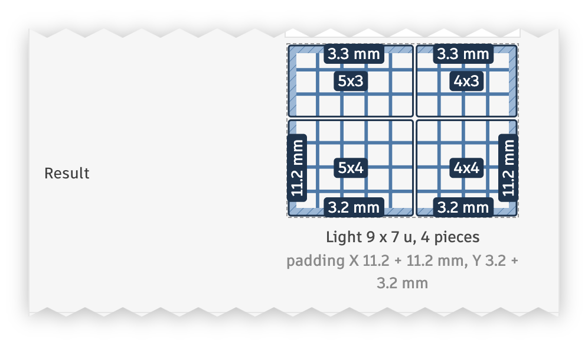</picture> |

### Print bed

The fill is split into the fewest pieces fitting the bed, the cells spread as evenly as possible between them, with the bigger pieces in the middle. The bed is tried both ways round and the one needing fewer pieces is used. Pieces meet with twice the **Plate edge clearance** between them.

#### Printer
Default: <!-- default:print_bed_preset_dropdown -->

Fills in the bed size of a popular printer, **Custom** keeps the size entered below.

#### Bed width, X and Bed length, Y
Default: <!-- default:print_bed_width --> by <!-- default:print_bed_length -->

The size of the print bed.

#### Bed margin
Default: <!-- default:print_bed_margin -->

Space kept clear on every side of the bed, a piece is at most the bed less twice the margin.

### Result

A drawing of the fill: the area, the grid in it, the pieces with their size in cells, half cells and padding. It updates as the inputs change, without generating anything.

## Grid units

### Plate width, X (u) and Plate length, Y (u)
Default: <!-- default:plate_width --> by <!-- default:plate_length -->

The number of cells along X and along Y. The plate's edges stop the **Plate edge clearance** short of the grid line, so plates can be laid side by side.

# Features

## Baseplate type
Default: <!-- default:plate_type_dropdown -->

<picture><source media="(prefers-color-scheme: dark)" srcset="../assets/gif/baseplate-types-dark.gif">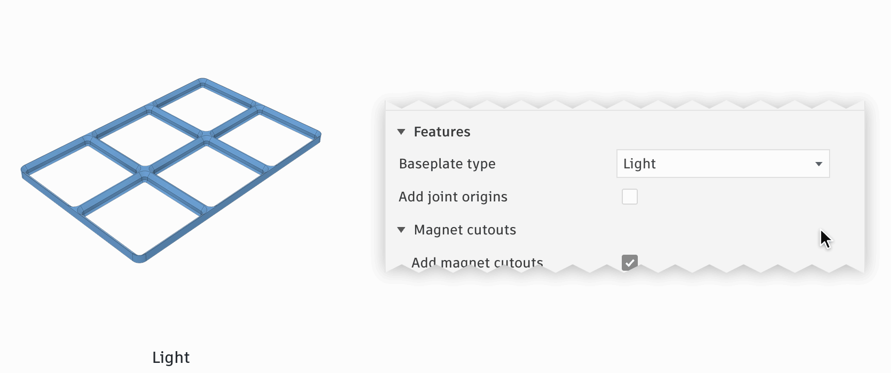</picture>

### Light

A thin plate of the socket profile alone, the minimal option. It takes the least material, and suits drawers and other places where the plate doesn't move. It has no magnet sockets, screw holes or connection holes.

### Skeletonized

A thick plate with the bottom cut away under each cell, lighter than full but stiff enough to carry around. It can have magnet sockets and screw holes, and connection holes on its sides to join plates together.

### Full

A thick plate with a solid bottom, the heaviest option. It takes the longest to print and the most material. It can have magnet sockets and screw holes.

Light | Skeletonized | Full
:-------------------------:|:-------------------------:|:-------------------------:
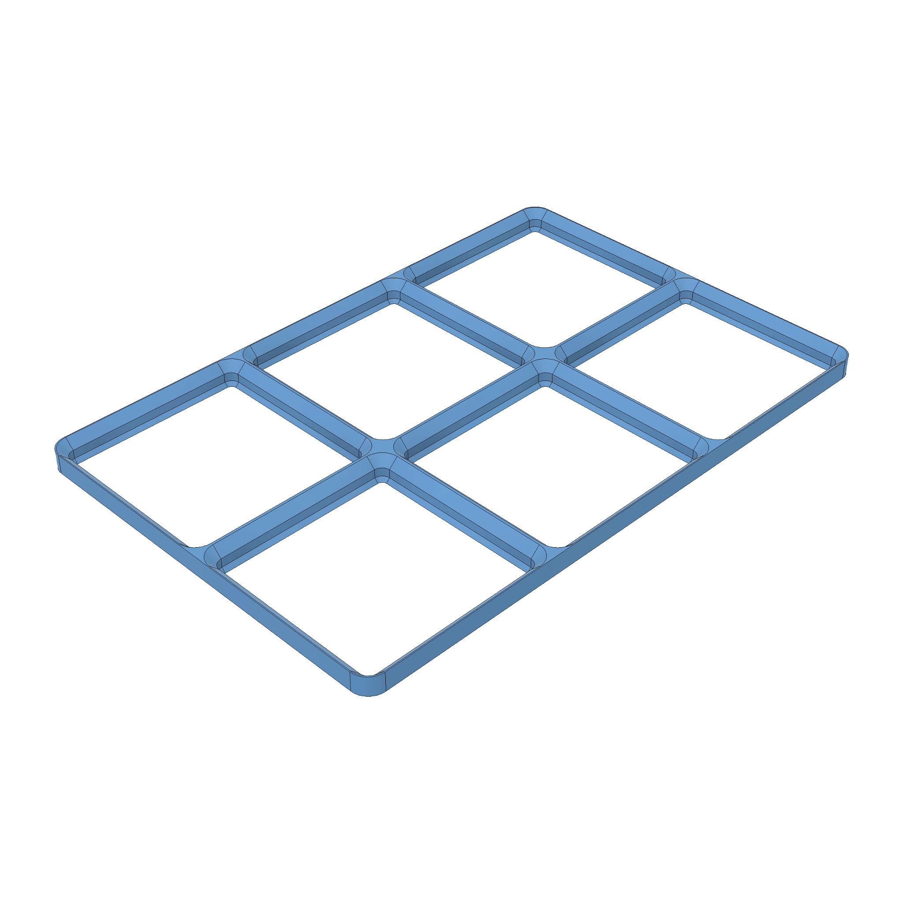 | 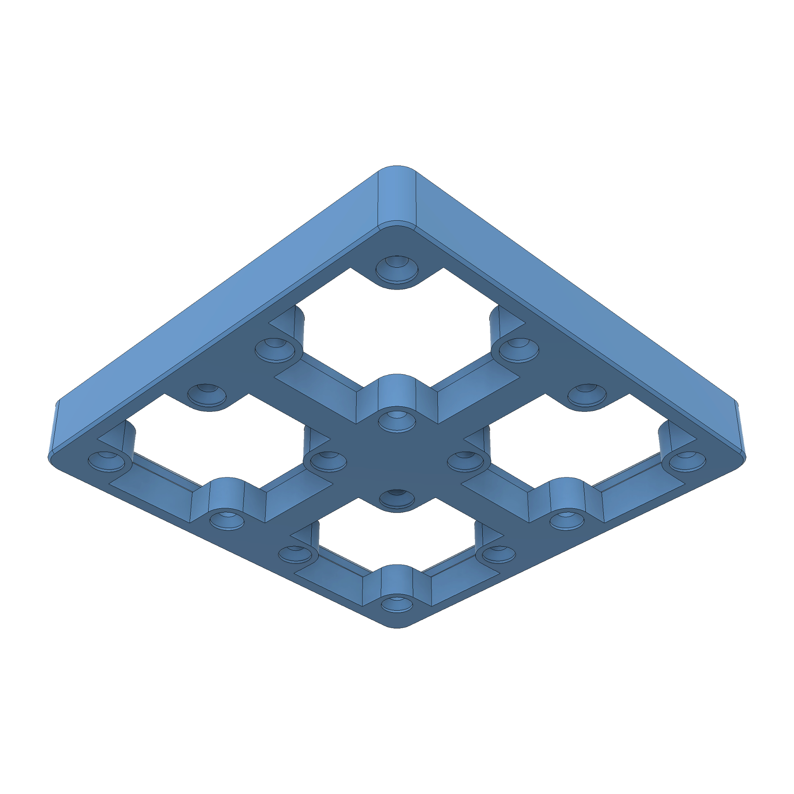 | 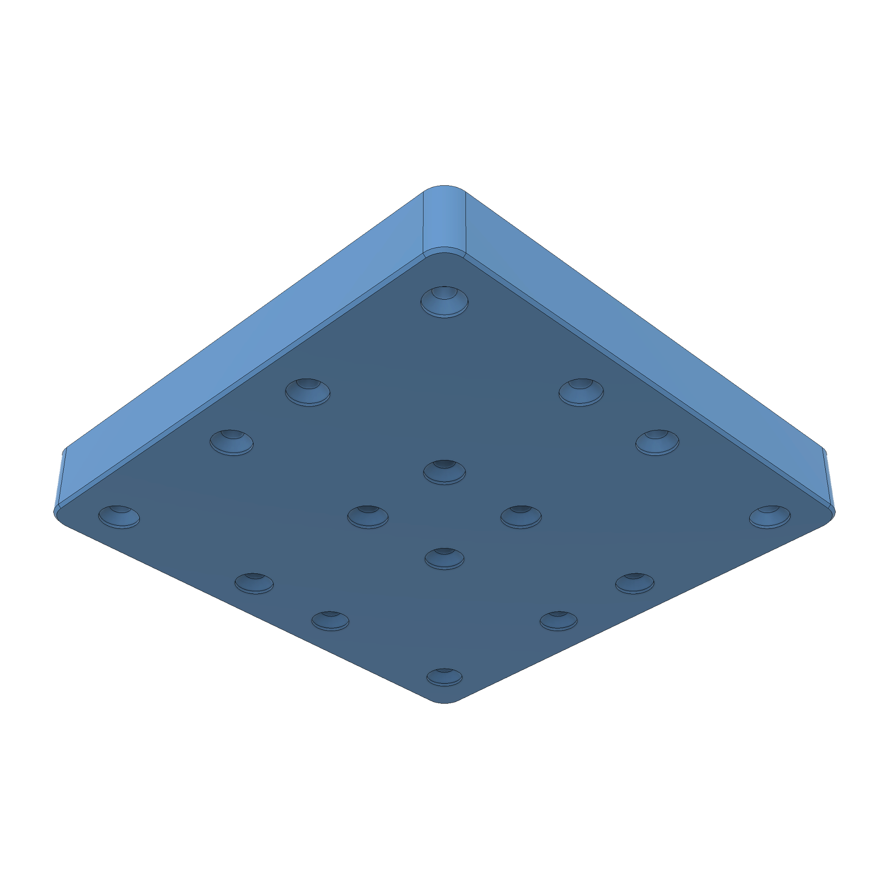

## Add joint origins
Default: <!-- default:has_joint_origins -->

A joint origin at the bottom center of every socket, to joint bins into the baseplate in an assembly. They're left out of the preview.

## Magnet cutouts

Sockets for magnets under each corner of a cell, for Skeletonized and Full plates, Light ones have no room for them.

### Add magnet cutouts
Default: <!-- default:with_magnet_cutouts -->

### Magnet cutout diameter
Default: <!-- default:magnet_diameter -->

The diameter of the magnet sockets, a little larger than the magnet for a snug fit. Up to 10mm.

### Magnet cutout depth
Default: <!-- default:magnet_height -->

How deep the magnet sockets go, the magnet's height.

## Screw holes

Holes through the plate under each corner of a cell, to screw bins down from below, for Skeletonized and Full plates.

### Add screw holes
Default: <!-- default:with_screw_holes -->

### Screw hole diameter
Default: <!-- default:screw_diameter -->

The diameter of the holes, to fit your screws. Up to 10mm.

### Screw head cutout diameter
Default: <!-- default:screw_head_diameter -->

The diameter of the countersink at the bottom of the plate for the screw heads, larger than the hole and up to 15mm.

## Side padding

Solid strips along the sides of a plate in **Grid units**, to fill the space between the plate and the walls of a drawer so it doesn't slide around. A filled area works out its padding on its own, so this section is only shown for grid units.

### Add side padding
Default: <!-- default:with_side_padding -->

### Padding left, Padding top, Padding right and Padding bottom
Default: <!-- default:side_padding_left -->

How wide the padding is on each side: left is -X, right +X, top +Y and bottom -Y, 0 leaves the side without one. Each side with padding gets a user parameter, such as `gfPlate1_paddingLeft`, to change it in place later.

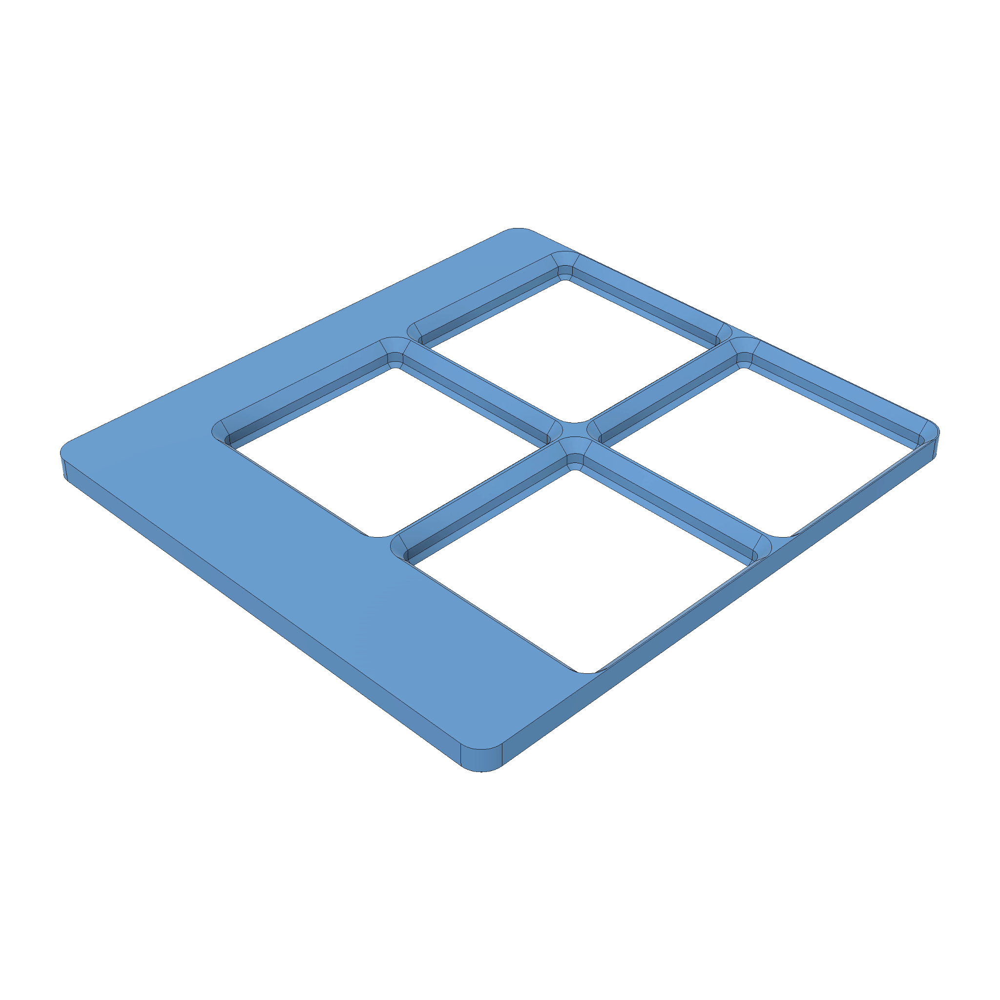

## Advanced plate size options

### Bottom padding (mm)
Default: <!-- default:extra_bottom_thickness -->

The solid layer under the sockets of Skeletonized and Full plates, where the magnet sockets and screw holes go. Thicker plates are stiffer and heavier. Not to be confused with **Padding bottom** of **Side padding**, the strip along the plate's -Y side.

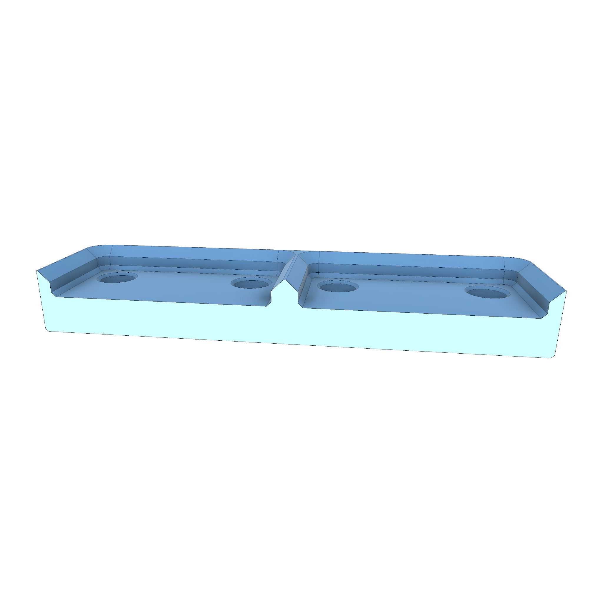

### Top trim (mm)
Default: <!-- default:bin_z_clearance -->

How much is cut off the top of the plate, leaving the ridges between the sockets flat, so a bin sits on its feet in the sockets rather than on the ridges, see the cross section under **Plate edge clearance**. From 0 to 3mm.

### Add connection holes
Default: <!-- default:has_connection_hole -->

Holes through the sides of Skeletonized plates, to join plates with screws or with pieces of filament glued in. They go through every outer side and through the seams between the pieces of a filled area, where they'd end up inside the plate.

<picture><source media="(prefers-color-scheme: dark)" srcset="../assets/gif/baseplate-connection-holes-dark.gif">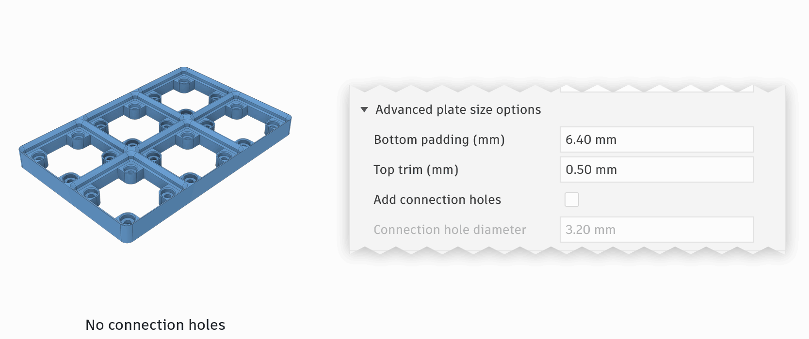</picture>

### Connection hole diameter
Default: <!-- default:connection_hole_diameter -->

The diameter of the connection holes, to fit your screws or filament. Up to 5mm.

# Inputs

Keeps the dialog's inputs between baseplates and Fusion sessions.

- **Save as defaults** saves the current inputs as the dialog's new defaults, the dialog opens with them
- **Reset to defaults** sets the inputs back to the saved defaults
- **Clear defaults** wipes the saved defaults and sets the inputs back to the original ones
- **Save to file** saves the settings to a JSON file, **Load from file** sets the inputs from one
- **Copy** copies the settings to the clipboard as JSON

A generated baseplate keeps its settings, its right-click menu shows them in **Gridfinity settings**, **Gridfinity rebuild** builds it again in place with changed settings and **Gridfinity clone** opens this dialog with them.

# Preview

Shows the baseplate before **OK** is clicked, to make adjustments first.

## Show preview (slow)
Default: <!-- default:show_preview -->

Updates the preview on every change of the inputs. It can be slow for large plates, as it builds the whole baseplate each time. Pieces of a filled area are spread apart in the preview, to tell them apart.

## Last preview

How long the last preview took.
