# Shape snapshot tests

Each case is a JSON file in [cases](cases) holding every setting of a bin or baseplate, lengths in mm and angles in
degrees. Its snapshot in [snapshots](snapshots), a folder named after the case, has the shapes it built, their
fingerprints and a preview picture.

Run them in Fusion from Utilities > Add-ins with **Gridfinity tests: run**, record new snapshots with **Gridfinity
tests: update snapshots**. The commands are there when the add-in runs from a git checkout.

A case with parameters sets those shared user parameters once built, the snapshot is of the bodies Fusion recomputed,
and a run also compares them with the case built with the new values from the start.

This page is written from the case files, run `python3 tests/e2e/write_readme.py` after adding or changing one.

## Bins

| Preview | Case | Description |
| --- | --- | --- |
|  | [bin_1_5x2_5x3_half_grid](cases/bin_1_5x2_5x3_half_grid.json) | 1.5x2.5x3 bin on the half grid, half size feet throughout |
| 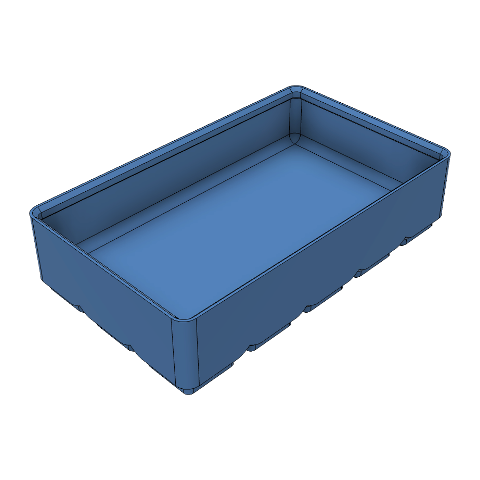 | [bin_1_5x2_5x3_half_grid_params_base_40](cases/bin_1_5x2_5x3_half_grid_params_base_40.json) | Half grid bin, base units lowered to 40 mm. Sets `gfBaseWidth` 40 mm, `gfBaseLength` 40 mm once built, a run compares that with a build using those values from the start |
| 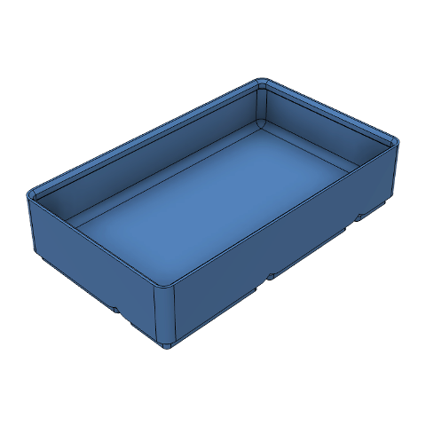 | [bin_1_5x2_5x3_half_size](cases/bin_1_5x2_5x3_half_size.json) | 1.5x2.5x3 bin on the whole grid, a row of half feet along two sides, with magnet and screw holes |
| 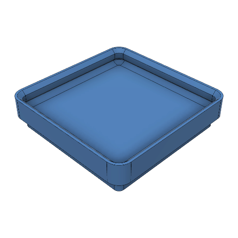 | [bin_1x1x1_lowest](cases/bin_1x1x1_lowest.json) | 1x1x1 bin, the lowest there is, with its lip |
| 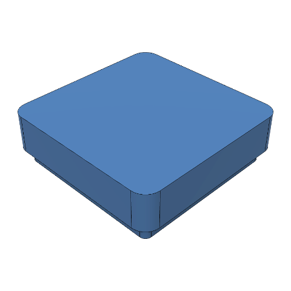 | [bin_1x1x2_solid_no_lip](cases/bin_1x1x2_solid_no_lip.json) | 1x1x2 solid bin without a lip |
| 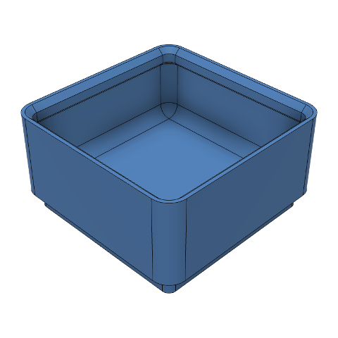 | [bin_1x1x3_40mm_6mm_units](cases/bin_1x1x3_40mm_6mm_units.json) | 1x1x3 bin on a 40 mm grid with 6 mm height units |
| 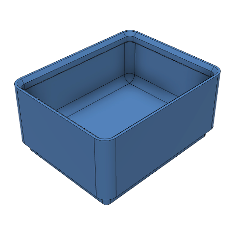 | [bin_1x1x3_params_base_40x50](cases/bin_1x1x3_params_base_40x50.json) | Plain 1x1x3 bin, base units changed to 40 by 50 mm. Sets `gfBaseWidth` 40 mm, `gfBaseLength` 50 mm once built, a run compares that with a build using those values from the start |
| 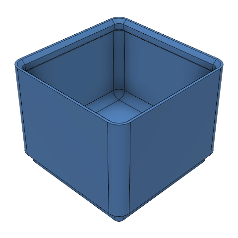 | [bin_1x1x3_params_height_unit_10](cases/bin_1x1x3_params_height_unit_10.json) | Plain 1x1x3 bin, height unit raised to 10 mm. Sets `gfHeightUnit` 10 mm once built, a run compares that with a build using those values from the start |
| 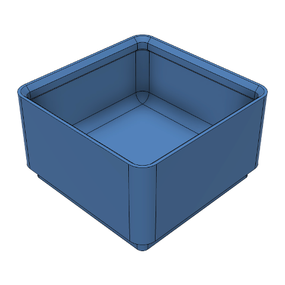 | [bin_1x1x3_plain](cases/bin_1x1x3_plain.json) | 1x1x3 hollow bin with a lip and nothing else, the baseline the other bin cases change one thing of |
| 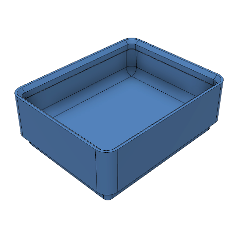 | [bin_1x1x3_units_40x50_5mm](cases/bin_1x1x3_units_40x50_5mm.json) | 1x1x3 bin on a 40 by 50 mm grid of 5 mm height units, base units of different sides |
|  | [bin_1x4x10_creases](cases/bin_1x4x10_creases.json) | 1x4x10 bin, tall and long enough for its long walls to fold in along creases |
| 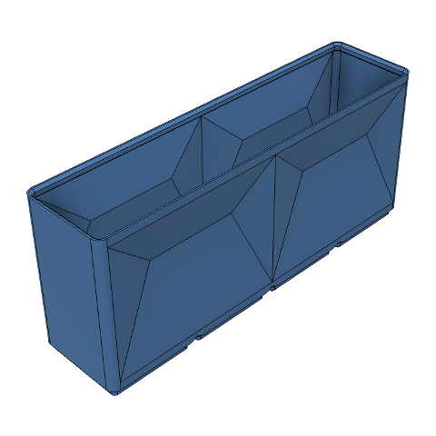 | [bin_1x4x10_creases_tuned](cases/bin_1x4x10_creases_tuned.json) | 1x4x10 bin with 3.5 mm deep creases folding its long walls in panels of at most 2 units |
| 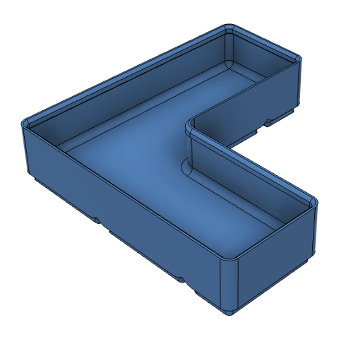 | [bin_2_5x2_5x3_l_shape_half_size](cases/bin_2_5x2_5x3_l_shape_half_size.json) | 2.5x2.5x3 L shaped bin on the whole grid, its arms end in half feet |
| 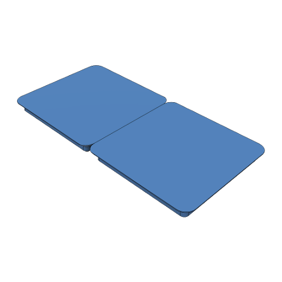 | [bin_2x1_base_only](cases/bin_2x1_base_only.json) | 2x1 bin base alone, no body |
| 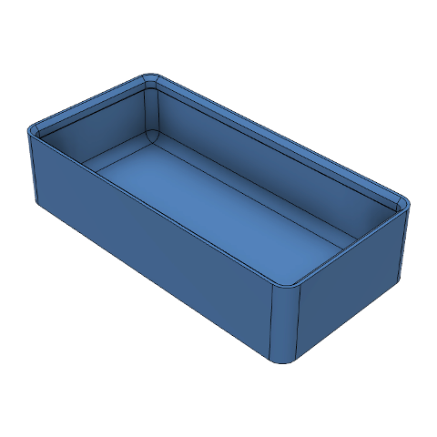 | [bin_2x1x3_body_only](cases/bin_2x1x3_body_only.json) | 2x1x3 bin body alone, no base |
|  | [bin_2x1x3_clearance_0_1](cases/bin_2x1x3_clearance_0_1.json) | 2x1x3 bin with the smallest clearance, 0.1 mm, magnet and screw holes placed from it |
|  | [bin_2x1x3_clearance_0_5](cases/bin_2x1x3_clearance_0_5.json) | 2x1x3 bin with the largest clearance, 0.5 mm, magnet and screw holes placed from it |
|  | [bin_2x1x3_deep_magnets_screws_no_grooves](cases/bin_2x1x3_deep_magnets_screws_no_grooves.json) | 2x1x3 bin with 4.5 mm deep magnet holes and screw holes, too deep for the printability groove to fit |
|  | [bin_2x1x3_holes_large](cases/bin_2x1x3_holes_large.json) | 2x1x3 bin with 10 mm by 4 mm magnet holes and 6 mm screw holes, wider than the printability groove |
|  | [bin_2x1x3_holes_small](cases/bin_2x1x3_holes_small.json) | 2x1x3 bin with 3 mm by 1 mm magnet holes and 1.5 mm screw holes |
| 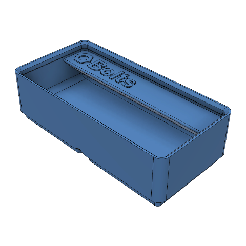 | [bin_2x1x3_label_icon_text_embossed](cases/bin_2x1x3_label_icon_text_embossed.json) | 2x1x3 bin with an embossed label of an icon and text |
| 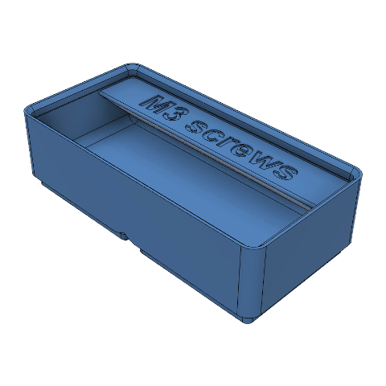 | [bin_2x1x3_label_text_engraved](cases/bin_2x1x3_label_text_engraved.json) | 2x1x3 bin with an engraved text label |
|  | [bin_2x1x3_magnets](cases/bin_2x1x3_magnets.json) | 2x1x3 bin with magnet holes only |
|  | [bin_2x1x3_magnets_pull_tabs](cases/bin_2x1x3_magnets_pull_tabs.json) | 2x1x3 bin with magnet holes opened to the side for pulling magnets out |
|  | [bin_2x1x3_magnets_pull_tabs_screws_grooves](cases/bin_2x1x3_magnets_pull_tabs_screws_grooves.json) | 2x1x3 bin with magnet holes opened to the side, screw holes and printability grooves |
|  | [bin_2x1x3_magnets_screws_grooves](cases/bin_2x1x3_magnets_screws_grooves.json) | 2x1x3 bin with magnet and screw holes, a printability groove bridges each magnet hole to its screw hole |
|  | [bin_2x1x3_screws](cases/bin_2x1x3_screws.json) | 2x1x3 bin with screw holes only |
| 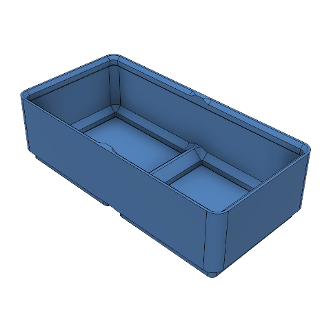 | [bin_2x1x3_shelled_notches](cases/bin_2x1x3_shelled_notches.json) | 2x1x3 shelled bin with lip notches |
|  | [bin_2x1x3_wall_0_4](cases/bin_2x1x3_wall_0_4.json) | 2x1x3 bin with the thinnest walls, 0.4 mm |
|  | [bin_2x1x3_wall_1_9](cases/bin_2x1x3_wall_1_9.json) | 2x1x3 bin with 1.9 mm walls, flush with the inside of the lip, still chamfered under it |
|  | [bin_2x1x3_wall_2_15](cases/bin_2x1x3_wall_2_15.json) | 2x1x3 bin with 2.15 mm walls, as thick as the lip wall, the first thickness without a chamfer under the lip |
| 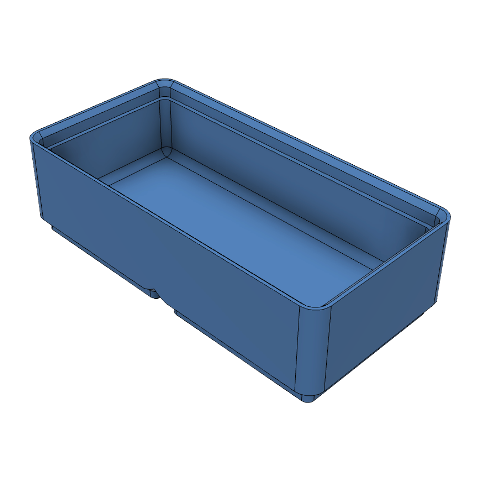 | [bin_2x1x3_wall_3](cases/bin_2x1x3_wall_3.json) | 2x1x3 bin with 3 mm walls, thicker than the lip |
|  | [bin_2x1x3_wall_3_scoop_compartments](cases/bin_2x1x3_wall_3_scoop_compartments.json) | 2x1x3 bin with 3 mm walls, thicker than the lip, a scoop and 2 compartments, placed against the lip |
| 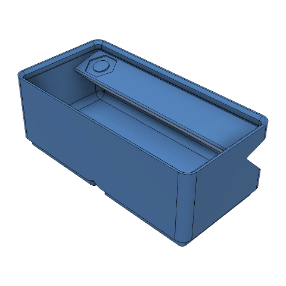 | [bin_2x1x4_hollow_tab_open_sides](cases/bin_2x1x4_hollow_tab_open_sides.json) | 2x1x4 bin with a hollow tilted tab open through the side walls, engraved icon label |
| 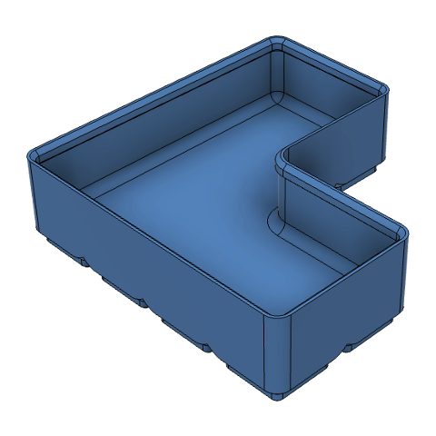 | [bin_2x2x3_l_shape_half_grid](cases/bin_2x2x3_l_shape_half_grid.json) | 2x2x3 L shaped bin on the half grid, drawn in half feet |
| 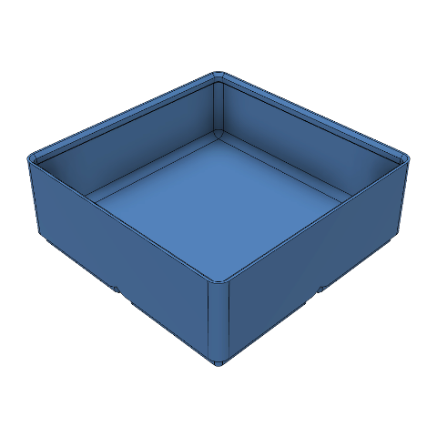 | [bin_2x2x4_scoop_radius_10](cases/bin_2x2x4_scoop_radius_10.json) | 2x2x4 bin with a scoop of at most 10 mm radius |
| 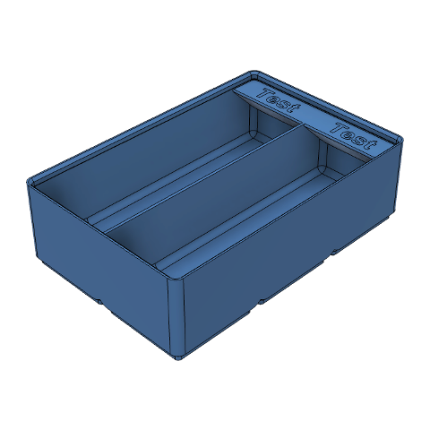 | [bin_2x3x5_features](cases/bin_2x3x5_features.json) | 2x3x5 hollow bin with a scoop, lip, labelled tab, 2 compartments, magnet and screw holes |
| 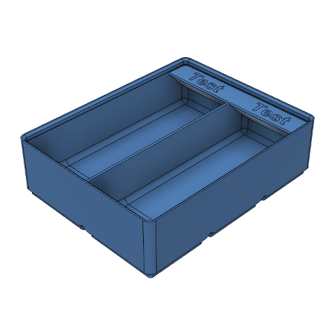 | [bin_2x3x5_features_params_all](cases/bin_2x3x5_features_params_all.json) | Bin with every feature, base and height units all changed. Sets `gfBaseWidth` 45 mm, `gfBaseLength` 38 mm, `gfHeightUnit` 6 mm once built, a run compares that with a build using those values from the start |
| 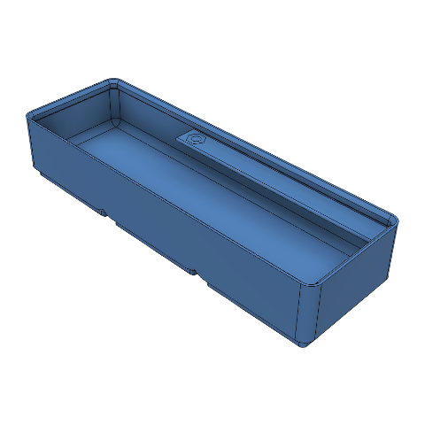 | [bin_3x1x3_tab_shallow_flat](cases/bin_3x1x3_tab_shallow_flat.json) | 3x1x3 bin with a two unit tab at the far end, 8 mm wide, the shallowest overhang, 65 degrees, and a flat top |
| 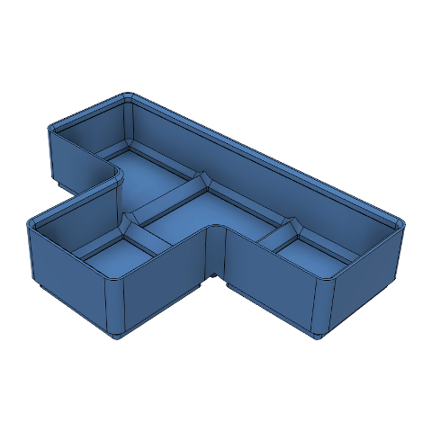 | [bin_3x2x3_t_shape_shelled](cases/bin_3x2x3_t_shape_shelled.json) | 3x2x3 T shaped shelled bin |
| 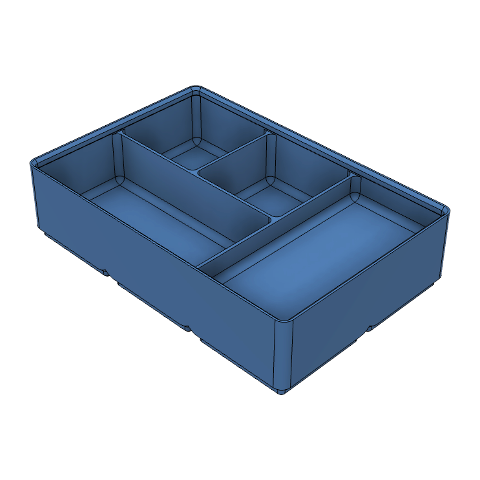 | [bin_3x2x4_merged_compartments](cases/bin_3x2x4_merged_compartments.json) | 3x2x4 bin with a 3x2 compartment grid, two merged pockets, one of them 10 mm shallower |
| 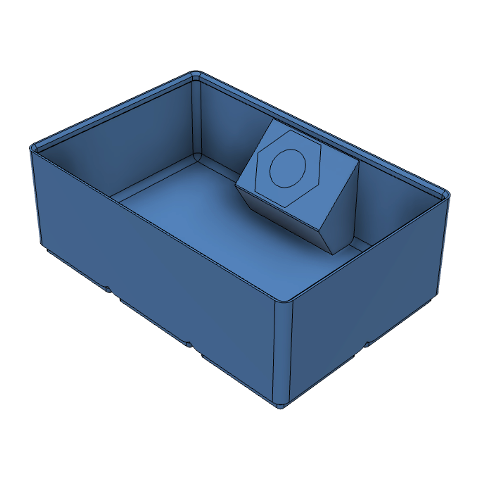 | [bin_3x2x6_tab_steep_tilted](cases/bin_3x2x6_tab_steep_tilted.json) | 3x2x6 bin with a one unit tab in the middle, 20 mm wide, the steepest overhang, 30 degrees, and the most tilted top, 45 degrees |
| 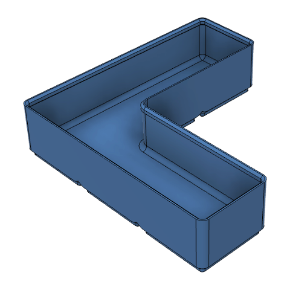 | [bin_3x3x4_l_shape](cases/bin_3x3x4_l_shape.json) | 3x3x4 L shaped hollow bin with a lip, no tab, one compartment, no holes |
|  | [bin_3x3x4_l_shape_lip_notches](cases/bin_3x3x4_l_shape_lip_notches.json) | 3x3x4 L shaped bin with lip notches |
| 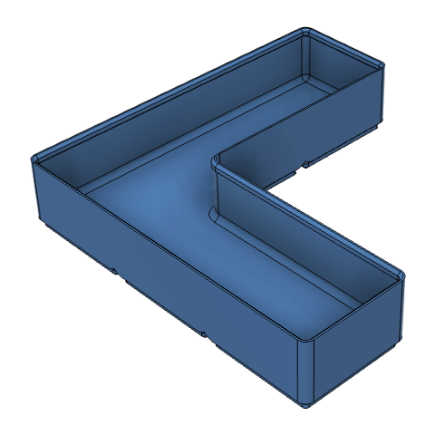 | [bin_3x3x4_l_shape_params_base_50](cases/bin_3x3x4_l_shape_params_base_50.json) | L-shaped bin, base units raised to 50 mm. Sets `gfBaseWidth` 50 mm, `gfBaseLength` 50 mm once built, a run compares that with a build using those values from the start |
|  | [bin_3x3x4_l_shape_wall_1_9](cases/bin_3x3x4_l_shape_wall_1_9.json) | 3x3x4 L shaped bin with 1.9 mm walls, flush with the inside of the lip, its chamfer under the lip follows the shape |
| 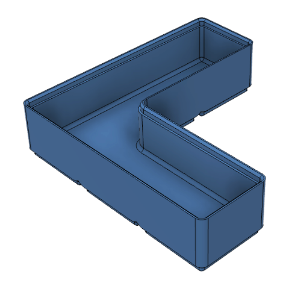 | [bin_3x3x4_l_shape_wall_3](cases/bin_3x3x4_l_shape_wall_3.json) | 3x3x4 L shaped bin with 3 mm walls, thicker than the lip |
| 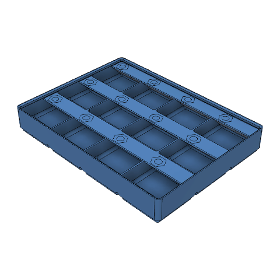 | [bin_4x3x3_compartments_4x3](cases/bin_4x3x3_compartments_4x3.json) | 4x3x3 bin with a 4x3 compartment grid, a scoop and a label tab along each row of compartments |

## Baseplates

| Preview | Case | Description |
| --- | --- | --- |
| 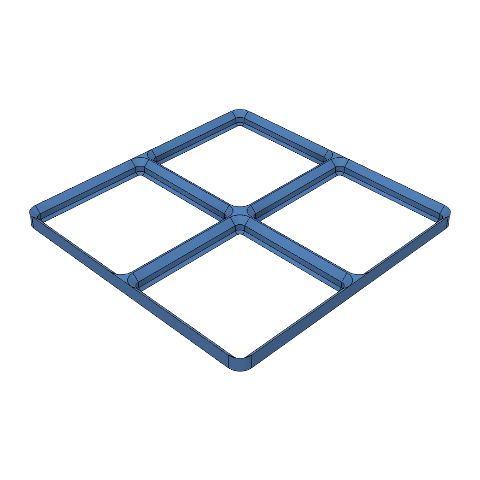 | [baseplate_2x2_light](cases/baseplate_2x2_light.json) | 2x2 light baseplate without holes, the baseline the other baseplate cases change one thing of |
| 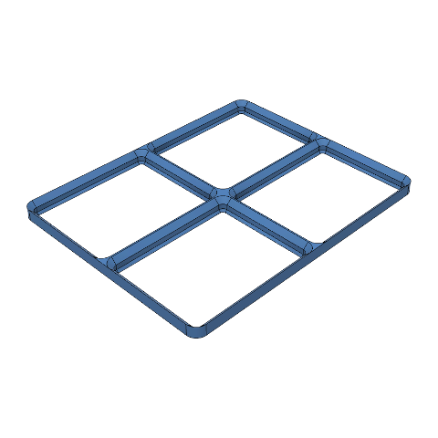 | [baseplate_2x2_light_params_base_40x50](cases/baseplate_2x2_light_params_base_40x50.json) | Light 2x2 baseplate, base units changed to 40 by 50 mm. Sets `gfBaseWidth` 40 mm, `gfBaseLength` 50 mm once built, a run compares that with a build using those values from the start |
| 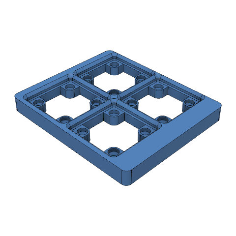 | [baseplate_2x2_skeletonized_padding](cases/baseplate_2x2_skeletonized_padding.json) | 2x2 skeletonized baseplate with magnet sockets and uneven padding |
| 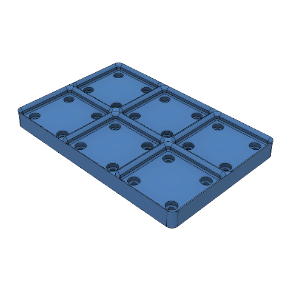 | [baseplate_3x2_full](cases/baseplate_3x2_full.json) | 3x2 full baseplate with magnet sockets, screw holes and connection holes |
| 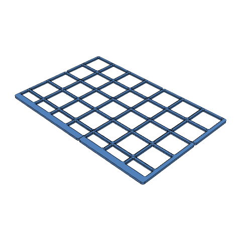 | [baseplate_fill_area_pieces](cases/baseplate_fill_area_pieces.json) | 300x200 mm area filled with a light baseplate, cut into pieces for a 180 mm print bed, half cells, aligned left and back |
